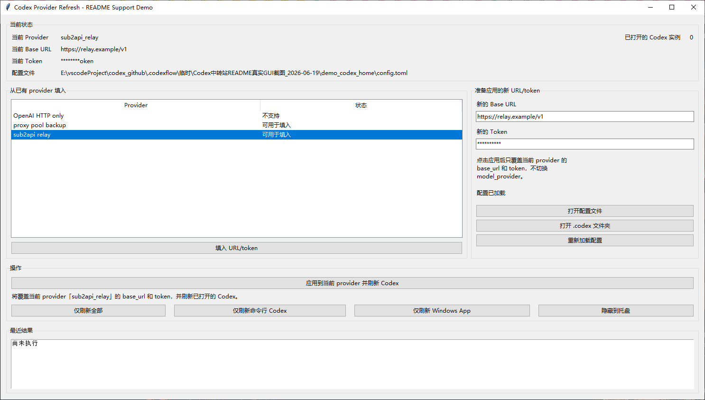

# Codex local3

**English** | [简体中文](README.zh-CN.md)

**Keep long tasks moving. Refresh connections while running. Work with multiple accounts.**

An independently maintained fork of OpenAI Codex CLI with broader automatic recovery, long-session improvements, and named accounts—plus a **Python GUI and system tray tool** for managing connections.

[Download for Windows](https://github.com/dqIndieGames/codex/releases/tag/rust-v0.165.0-local3) · [Compare features](#comparison) · [Python tool](#python-provider-refresh) · [Quick start](#quick-start) · [Full checklist](#full-checklist)

> **Using Codex to improve Codex, since GPT-5.3-Codex.**
> 100% of this fork’s custom improvements were implemented using Codex, with requirements and review provided by the maintainer. Development continues as models and upstream releases evolve. The upstream code remains the work of OpenAI and its contributors.

## Why local3?

- **Fewer manual retries:** automatically wait through rate limits, model overload, and disconnected streams; fall back to HTTP when WebSocket recovery reaches its threshold.
- **Fewer restarts:** update the service URL or token and refresh running instances from the Python window or tray.
- **Less repeated setup:** keep account credentials separate while sharing configuration, sessions, skills, and MCP settings.

## Comparison

Based on upstream [`rust-v0.165.0`](https://github.com/openai/codex/tree/rust-v0.165.0) and the local3 source. These are version-specific differences, not claims about every upstream release.

| Scenario | Upstream behavior and limits | What local3 adds |
| --- | --- | --- |
| **429 / model overload** | Already retries some errors, but error classification, server advice, and retry budgets can end the task. | **Retries continuously by default.** Honors valid server wait advice; otherwise waits 10 seconds, reducing manual resubmissions. |
| **Repeated WS disconnects** | For ordinary retryable stream failures, defaults to **5 retries** before HTTP fallback: the initial attempt plus 5 retries must fail. | Switches to HTTP after **3 consecutive WS failures within one request**, reducing unsuccessful WS attempts. |
| **Oversized WS messages** | Treats close code `1009` as an ordinary stream failure, without a dedicated early fallback. | Uses HTTP on the next attempt after the first `1009`, without another WS attempt. The retry wait still applies. |
| **Connection changes while running** | Does not include this fork’s combined instance-refresh and active-request interruption mechanism. | Interrupts old connections and waits when the URL or credentials change. Subsequent requests use the new settings, **including token-only changes at the same URL**. |
| **Multiple accounts** | Supports ChatGPT / API-key login, without this fork’s `--account` named-account entry point. | **Separate credentials, shared setup.** Terminal titles identify the account or provider to help distinguish windows. |
| **Updated credentials after 401** | Has authentication recovery, but does not continuously reread the credential file on every 401. | For file-backed authentication, rereads the selected account’s file after every 401. Invalid files do not replace cached credentials. |
| **Resume after changing providers** | The resume picker filters by provider by default. | Finds sessions across providers and resumes using the current provider. The local fork picker still filters by provider. |
| **Image-heavy history** | Has context compaction, without this fork’s four-stage image ladder and replay records. | First adjusts older images’ detail, then replaces older images with placeholders if needed. Prioritizes recent images and **preserves original files on disk**. |

<details>
<summary>Retry rules and exceptions</summary>

- **Wait advice:** HTTP 429 and `Selected model is at capacity` do not always include `Retry-After`. local3 honors valid server advice; otherwise it waits 10 seconds. One failure causes one wait; switching transport does not bypass the deadline.
- **Upstream exceptions:** five is the configurable default stream retry budget. A 426 handshake response can trigger immediate HTTP fallback; certain connection failures use a separate continuous-reconnection path.
- **local3 scope:** ordinary model requests and context compaction share the WS fallback rules. Once activated, HTTP remains in use for that session and subsequently spawned subagents. A new session or restart selects transport from configuration again.
- **Recovery limits:** quota, billing, or configuration errors may also keep retrying. Waiting alone cannot guarantee recovery; cancel and address the cause when necessary.

</details>

### Long sessions and quieter background operation

- **Commit compaction only when complete:** stage the output until completion and validation, so a failed attempt does not commit a partial summary. Retry counts remain visible; intermediate failures stay out of conversation history.
- **Recover relay connections:** every third retry checks and clears applicable client-controlled routing state. The official ChatGPT Codex backend skips relay-specific recovery; this cannot guarantee that a relay changes its backend account.
- **Reduce background output and small writes:** analytics, feedback, and log_db are disabled by default. Batch session writes and coalesce frequent notifications while preserving completion and persistence boundaries. Explicit controls remain available.

## Python Provider Refresh

**Manage connections in one window and refresh the instances you choose.** The Python / Tk GUI and tray tool update the current provider’s settings while preserving its `model_provider` configuration key.



*Existing repository demo screenshot; the token is masked. Some button labels differ from the current source.*

| Action | Result |
| --- | --- |
| Load an existing provider | Fill in the Base URL, token, or AuthManager settings from configuration. |
| Apply and refresh | Update the current provider and refresh instances. Report saving and refreshing separately, including when no instance was refreshed. |
| Refresh all / CLI / Windows App | Choose which class of running instances to refresh. |
| Reload configuration / use the tray | Read configuration again, open its directory, or hide the window in the tray. |

### Run the tool

On **Windows with Python 3.11+ and Tk**, download or clone this repository and run from its root:

```powershell
python -m pip install pystray Pillow
python scripts/windows_app_server_refresh_tray.py
```

Choose **“打开主窗口” (Open main window)** in the tray menu. Enter the URL and token, then select **“应用到当前 provider 并刷新 Codex” (Apply to current provider and refresh Codex)**. Leaving the token empty restores AuthManager authentication.

The minimal Windows Release contains only `codex.exe`; run the Python tool separately from the repository. Instance refresh requires a running build that supports the local3 control interface.

## Quick start

1. Download `codex-x86_64-pc-windows-msvc-minimal.zip` from [0.165.0-local3](https://github.com/dqIndieGames/codex/releases/tag/rust-v0.165.0-local3) and extract `codex.exe`.
2. Run `.\codex.exe` from the extracted directory and follow the login prompts. For a compatible provider, configure its URL and authentication as required.
3. For a separate account, run `.\codex.exe --account work`. Credentials are isolated; configuration, sessions, skills, and MCP settings remain shared.
4. Start Provider Refresh when you need to change connection settings while Codex is running.

The upstream installers, `npm install -g @openai/codex`, and Homebrew install the official distribution. Use this fork’s Release above to get local3.

## Full checklist

<details>
<summary>21 custom features and maintenance requirements</summary>

1. Display `-local3` locally; separate display and outbound versions. A remote-registration field remains pending, as noted below.
2. Show the feature list once when a new thread’s first plain-text input is exactly `你好`.
3. Retry main model requests continuously by default, including 429 and model overload; honor valid server advice, otherwise wait 10 seconds.
4. Show cumulative retry counts; keep intermediate failures out of persisted history.
5. Discover and resume sessions across providers; retain provider filtering in the local fork picker.
6. Request priority by default, with an option to restore upstream Fast / Flex / None behavior. Actual service and pricing depend on the provider.
7. Disable analytics, feedback, and log_db by default, with explicit opt-in.
8. Batch session writes and coalesce frequent app-server notifications, with a switch to disable batching.
9. Cover app-server, TUI, exec, subagents, agent_jobs, and tray in the refresh requirements; verify each entry point for the build in use.
10. Interrupt old requests, waits, and authenticated WS connections on refresh, including token-only changes.
11. Select HTTP after the first WS 1009 or three consecutive WS failures within one request. Honor the retry wait and keep HTTP for the session.
12. Report configuration saving separately from actual instance refresh.
13. Keep app-server stderr quiet by default, with opt-in diagnostics and necessary startup/configuration errors.
14. Set node_repl’s `CODEX_CLI_PATH` to the current CLI so child tools do not accidentally use an older build.
15. Release existing runtime references on exit, without globally killing processes or stopping loaded threads merely because a UI disconnects.
16. Isolate provider-owned tokens from global login state; restore AuthManager when the provider token is removed.
17. Separate Windows cloud builds, downloaded-artifact checks, promotion, and Release verification.
18. Share the four-stage image ladder between model requests and compaction. Use lightweight `ImagesShrunk` records for resume/fork replay; preserve files on disk.
19. Use `--account` for separate credentials and account/provider title labels.
20. Reread the selected credential file after each 401; invalid files do not overwrite the cache.
21. Keep outbound versions and non-authentication request behavior consistent across default/named accounts. Actual request parity remains to be verified.

[Detailed local3 checklist and acceptance criteria (Chinese)](docs/local3-custom-feature-checklist-2026-05-10.md)

</details>

<details>
<summary>Image handling and recovery boundaries</summary>

- **Image ladder:** context-limit or HTTP 413 failures advance the ladder every third relevant failure. First preserve the last 5, then 1 image while changing older `original` detail to `high`; later preserve the last 5, then 1 actual image while replacing older images with 1×1 placeholders. Skip stages that make no change.
- **Image tradeoff:** the first two stages change detail rather than re-encoding image files. The later stages remove older visual information from the model’s input. Original files remain on disk; WS 1009 selects HTTP without directly advancing the ladder.
- **Realtime / WebRTC:** connection recovery uses separate paths; it does not use the Responses WS-to-HTTP fallback.
- **Retry control:** users can cancel. Finite retry budgets apply in bounded mode; a zero budget disables the corresponding retry layer.
- **Service tier:** priority can be disabled at the top level. The service provider determines availability and billing.

</details>

<details>
<summary>Known limitations and verification scope</summary>

- Remote-control registration still uses the display version with the local3 suffix for `app_server_version`; this remains to be fixed.
- Named accounts do not implicitly reuse a shared daemon with a single authentication context. Unsupported daemon/proxy entry points reject them.
- This introduction is based on source comparison and the feature checklist. It is not an end-to-end certification of every refresh entry point or default/named-account request parity.
- Local source additions may differ from the public branch or published binary. The investigation into a terminal staying busy after completion is not listed as a verified fix.

Comparison baseline: [upstream 0.165.0 commit](https://github.com/openai/codex/commit/360319d8dee62d87e2d59fc0c21805d79519cfed) · [Python tool source](scripts/windows_app_server_refresh_tray.py)

</details>

## Upstream, docs, and community

Thanks to [OpenAI Codex](https://github.com/openai/codex) and its contributors. This is an independently maintained fork, not an official OpenAI release, and remains licensed under [Apache-2.0](LICENSE).

- [Official Codex documentation](https://developers.openai.com/codex)
- [Contributing](docs/contributing.md)
- [Upstream installation and build documentation](docs/install.md)
- [Open source fund documentation](docs/open-source-fund.md)

Release workflow: GitHub build → verify the downloaded artifact → promote through GitHub → download the Release and check hashes.

The project is shared in the [LINUX DO](https://linux.do/) community. Reports with concrete use cases and reproduction steps are welcome.
