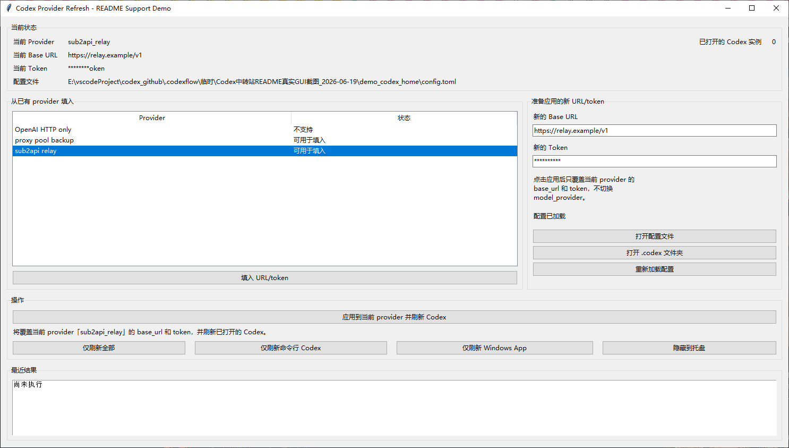

# Codex local3

[English](README.md) | **简体中文**

**长任务少中断，连接随时刷新，多账号并行工作。**

基于 OpenAI Codex CLI 独立维护的开源定制分支，增强限流恢复、长会话与多账号管理，并配套 **Python 图形界面与托盘工具**。

[下载 Windows 版本](https://github.com/dqIndieGames/codex/releases/tag/rust-v0.165.0-local3) · [功能对比](#功能对比) · [Python 工具](#python-管理工具provider-refresh) · [快速开始](#快速开始) · [完整清单](#完整清单)

> **从 GPT-5.3-Codex 开始，一路使用 Codex 优化 Codex。**
> 本分支的定制优化 **100% 使用 Codex 完成**，由维护者提出需求、审核结果，随着模型与上游版本持续迭代。上游基础代码归 OpenAI 及原贡献者。

## 为什么选择 local3？

- **少手动重发：** 限流、模型满载或断流时自动等待恢复，WS 失败达到条件后改用 HTTP。
- **少退出重开：** 用 Python 窗口或托盘更新服务地址与 token，刷新运行中的实例。
- **少重复配置：** 多账号独立认证，共享配置、会话、skills 和 MCP。

## 功能对比

以下对照官方 [`rust-v0.165.0`](https://github.com/openai/codex/tree/rust-v0.165.0) 与本地 local3 源码，说明同版本的定制增量，不泛指所有官方版本。

| 使用场景 | 官方同版本的行为与限制 | local3 的改进与收益 |
| --- | --- | --- |
| **429／模型满载** | 已有自动重试，但受错误类型、等待建议和重试预算限制，部分情况会结束任务。 | **默认持续重试**；优先遵守服务端等待建议，无有效建议时等 10 秒，减少手动重新发送。 |
| **WS 反复断流** | 普通可重试断流默认重试 **5 次**仍失败才转 HTTP，即首次＋重试共 6 次失败。 | 同一请求连续 **3 次 WS 失败**后转 HTTP，减少无效 WS 尝试。 |
| **WS 消息过大** | `1009` 按普通断流处理，没有专门提前回退。 | 首次 `1009` 后下一次尝试改用 HTTP，不再重复尝试 WS；发送仍遵守等待规则。 |
| **运行中换连接配置** | 未提供本分支的批量实例刷新与活动请求中断机制。 | 刷新地址或 token 时中断旧连接及等待，后续请求使用新配置；**同地址换 token 也生效**。 |
| **多账号并行** | 已有 ChatGPT／API Key 登录，不含本分支的 `--account` 命名账号入口。 | **认证独立、配置共享**，减少重复配置；终端标题标识账号或 Provider，方便区分窗口。 |
| **401 后更新凭据** | 已有认证恢复流程，但并非每次 401 都持续重读认证文件。 | 文件认证遇到每次 401 都重读所选账号文件，让运行实例获取更新后的凭据；坏文件不覆盖缓存。 |
| **换 Provider 继续任务** | resume 选择器默认按 Provider 筛选，查找其他 Provider 的旧会话不方便。 | **跨 Provider 查找并继续旧会话**，按当前 Provider 接着工作；本地 fork 选择器仍按 Provider 筛选。 |
| **历史图片过多** | 已有上下文压缩，没有本分支的四档图片处理与重放记录。 | 前两档调整旧图 detail，后两档以占位图缩减图片负担；优先保留近期图片，**磁盘原图不变**。 |

<details>
<summary>重试规则与例外</summary>

- **等待：** HTTP 429 或 `Selected model is at capacity` 不保证带有 `Retry-After`。local3 优先遵守有效等待建议，无建议时默认等 10 秒；同一次失败只等待一次，换协议不跳过期限。
- **官方例外：** 5 次是默认流式重试预算，可配置；426 握手响应可直接回退，特定网络连接失败另走持续重连机制。
- **local3 范围：** 普通对话和上下文压缩共用 WS 回退规则。回退后当前会话及此后新开的子代理保持 HTTP，新会话或重启后按配置重新选择。
- **恢复边界：** 额度耗尽、计费或配置错误也可能持续重试，单靠等待不保证恢复；用户可以取消并处理原因。

</details>

### 长会话与后台使用也更省心

- **压缩结果完整再保存：** 收到完成事件且结果有效后才提交，失败尝试不写入半成品摘要；重试次数持续显示，中间失败不混入历史。
- **中转连接尝试恢复：** 每累计 3 次重试检查并清理客户端可控的路由状态；官方 ChatGPT Codex 后端跳过中转专用处理，不保证第三方服务换号。
- **减少后台输出与小写入：** 默认关闭 analytics、feedback、log_db；合并会话小写入和高频通知，保留完成、持久化边界及显式开关。

## Python 管理工具：Provider Refresh

**在一个窗口管理连接，按范围刷新 Codex。** Python / Tk 界面与系统托盘更新当前 Provider 的配置，保留 `model_provider` 配置键。



*仓库已有演示截图，token 已遮罩；部分按钮文案与现行源码不同。*

| 操作 | 作用 |
| --- | --- |
| 从已有 Provider 填入 | 从配置填入 Base URL、token 或 AuthManager。 |
| 应用并刷新 Codex | 更新当前 Provider 并刷新实例；分别显示保存与实际刷新结果，无实例时明确提示。 |
| 仅刷新全部／命令行／Windows App | 按范围刷新实例，适合只更新某一类运行入口。 |
| 配置重载与托盘 | 重新读取配置、打开配置目录，或隐藏到系统托盘。 |

### 启动工具

准备 **Windows、Python 3.11+（含 Tk）**，下载或克隆本仓库源码，在源码根目录执行：

```powershell
python -m pip install pystray Pillow
python scripts/windows_app_server_refresh_tray.py
```

在系统托盘菜单选择“打开主窗口”。填入地址与 token，再点击“应用到当前 provider 并刷新 Codex”；token 留空可恢复 AuthManager 认证。

Windows 最小 Release 包仅包含 `codex.exe`；Python 工具从仓库源码单独运行。刷新实例需要支持 local3 控制接口的运行程序。

## 快速开始

1. 从 [0.165.0-local3 Release](https://github.com/dqIndieGames/codex/releases/tag/rust-v0.165.0-local3) 下载 `codex-x86_64-pc-windows-msvc-minimal.zip`，解压获得 `codex.exe`。
2. 在解压目录启动 `.\codex.exe`，按提示登录；使用兼容 Provider 时，按其要求配置地址与认证。
3. 需要独立账号时，使用 `.\codex.exe --account work`。认证隔离，配置、会话、skills 与 MCP 继续共享。
4. 需要运行中调整连接配置时，启动 Provider Refresh 工具。

上游安装脚本、`npm install -g @openai/codex` 和 Homebrew 安装的是官方版本；使用上方本分支 Release 获取 local3。

## 完整清单

<details>
<summary>21 项定制功能与维护要求</summary>

1. 本机显示 `-local3`，对外版本按用途分离；远程注册字段仍待修，见下方限制。
2. 新线程首次纯文本“你好”显示一次功能清单，快速了解定制功能。
3. 主链覆盖 429、模型满载等错误，默认持续重试；优先遵守有效等待建议，未提供时等 10 秒。
4. 显示持续累计的重试次数，中间失败不混入持久化历史。
5. 跨 Provider 发现与继续历史会话；本地 fork 选择器仍按 Provider 筛选。
6. 默认请求 priority，可关闭恢复官方 Fast / Flex / None；实际服务与计费取决于服务方。
7. analytics、feedback、log_db 默认关闭，可显式开启。
8. 会话记录批量写盘与高频 app-server 通知合并，保留关闭开关。
9. 刷新要求覆盖 app-server、TUI、exec、subagent、agent_jobs 和 tray；各入口仍需按版本验收。
10. 刷新中断旧请求、等待和认证 WS，同地址换 token 也处理。
11. WS 1009 首次发生即选择 HTTP；其他 WS 失败在同一请求内连续 3 次后回退。发送仍按等待规则，本会话保持 HTTP。
12. 保存成功与实际刷新实例分开反馈。
13. app-server stderr 默认安静，可开启诊断；保留必要的启动和配置错误。
14. node_repl 的 `CODEX_CLI_PATH` 指向当前 CLI，避免工具子进程误用旧版本。
15. 退出时释放已有 runtime 引用，不全局结束进程，不因 UI 断开误停已加载线程。
16. Provider 自带 token 与全局登录态隔离；移除 token 后恢复 AuthManager。
17. Windows 云端构建、下载 artifact 验证、promotion 与 Release 核验分离。
18. 普通请求与压缩共用四档图片处理；`ImagesShrunk` 轻量记录支持 resume / fork 重放，磁盘原图保留。
19. `--account` 独立认证文件与账号／Provider 标题标识。
20. 每次 401 重读所选认证文件，坏文件不覆盖缓存。
21. 默认与命名账号的对外版本及非认证请求行为保持一致；实际请求一致性仍待验收。

[查看完整 local3 清单与验收标准](docs/local3-custom-feature-checklist-2026-05-10.md)

</details>

<details>
<summary>图片处理与恢复边界</summary>

- **图片梯子：** 上下文超限或 HTTP 413 每累计 3 次相关失败推进。先保留最近 5／1 张图片，将更早图片的 `original` detail 改为 `high`；后两档保留最近 5／1 张真实图片，将更早图片替换为 1×1 占位图。无变化档位跳过。
- **图片取舍：** 前两档调整 detail，不重新编码图片文件；后两档会移除模型输入中的旧图信息。磁盘原图保留，WS 1009 只选择 HTTP，不直接推进图片梯子。
- **Realtime／WebRTC：** 使用独立连接恢复路径，不执行 Responses 的 WS → HTTP 回退。
- **重试控制：** 用户可以取消；有限预算在 bounded 模式下生效，零预算关闭对应层重试。
- **服务层：** priority 可在顶层关闭；实际可用性与计费由服务方决定。

</details>

<details>
<summary>当前限制与核对范围</summary>

- 远程控制注册的 `app_server_version` 仍使用带 local3 后缀的展示版本，尚待修复。
- 命名账号不隐式复用单一认证上下文的共享 daemon；未支持隔离的 daemon／proxy 入口会拒绝。
- 本文依据源码对比与功能清单，不代表所有刷新入口及默认／命名账号请求一致性已完成端到端实测。
- 本地源码补充可能与公开分支或已发布程序不同。“回复完成后终端仍忙碌”的排查未列为已验证修复。

对比基线：[官方 0.165.0 提交](https://github.com/openai/codex/commit/360319d8dee62d87e2d59fc0c21805d79519cfed) · [Python 工具源码](scripts/windows_app_server_refresh_tray.py)

</details>

## 上游、文档与社区

感谢 [OpenAI Codex](https://github.com/openai/codex) 及上游贡献者。本项目是独立维护的分支，非 OpenAI 官方发布版，沿用 [Apache-2.0](LICENSE) 许可证。

- [官方 Codex 文档](https://developers.openai.com/codex)
- [贡献指南](docs/contributing.md)
- [上游安装与构建说明](docs/install.md)
- [开源基金说明](docs/open-source-fund.md)

发行流程：GitHub 编译 → 验证下载的 artifact → GitHub promotion → 回下载 Release 核对哈希。

项目在 [LINUX DO](https://linux.do/) 社区分享，欢迎带着具体使用场景和复现步骤参与讨论。
